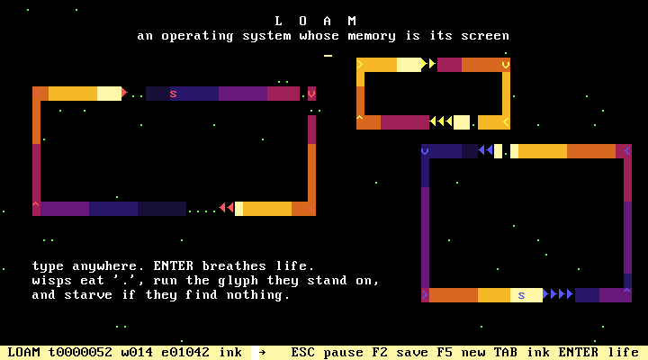

# LOAM

An operating system whose memory is its screen.  Boots on x86-64 (BIOS), ~13 KB.
Everything here -- boot sector, kernel, execution model, "language" -- is original code.

## The idea

A normal OS keeps *memory*, *processes*, *files* and a *scheduler* as separate things and
spends enormous effort keeping them apart.  Loam has one thing: **a surface**.

The 80x24 VGA text buffer *is* the heap.  There is no framebuffer copy and no render step;
changing memory changes what you see.  Every cell is 16 bits:

    bits 12-14  HEAT   how recently life touched this cell   (drawn as background colour)
    bits  8-11  OWNER  who wrote it                          (drawn as text colour)
    bits  0-7   GLYPH  one byte: data AND instruction, same thing

Programs are **wisps** -- bodies that stand on a cell, execute its glyph, and step forward.
The screen you look at is the program you are running; editing and executing are one act.

| Conventional OS      | Loam                                                              |
|----------------------|-------------------------------------------------------------------|
| process / thread     | a wisp (visible as a coloured pointer)                            |
| scheduler            | none -- every wisp advances one cell per tick                     |
| malloc / free        | claim ground by writing; unused ground goes back to nature        |
| kill / OOM killer    | metabolism: 1 energy/tick; no food = death, and the body is recycled into food |
| memory protection    | price: overwriting a foreign cell costs 6 energy, human text costs 24 |
| IPC                  | stigmergy: wisps leave glyphs and heat that others read           |
| files / filesystem   | none                                                              |
| boot / shutdown      | none: the world is snapshotted to disk every ~10 s and on F2, and wakes up pixel-identical |
| init                 | genesis(): the first world, built from the same glyphs            |

Ecology: wisps eat `.` (+14 energy).  Cooled trails sprout new food on unowned ground,
rain adds a little, and old food rots.  So populations boom, starve and recover on their own.

## Instruction set (the glyph under a wisp)

    > v < ^   face east/south/west/north        ] [   turn right / left
    + -       acc++ / acc--                      * /   acc<<=1 / acc>>=1
    0..9      acc = digit                        '     acc = next glyph, hop over it (literal)
    ?         if acc==0, hop over next cell      r     acc = glyph on my right hand
    w         write acc onto my right hand       h     acc = heat of the cell ahead
    s         bud: split a child behind me       x     die (becomes food)
    k         acc = last typed key               ~     beep (pitch from acc)
    #         bark: a wall, wisps bounce off     .     food (eaten on arrival)
    anything else: does nothing; the wisp walks straight on

Crowded cells: a wisp waits.  The world is a torus.  Worked example (a "scribe"):

    'Hw'iw'!w       a wisp heading east writes  H . . i . . !  on the row below it

## Keys

    arrows  move the cursor (also set the direction you type in and breathe in)
    typing  writes glyphs into the world, in the current ink colour
    ENTER   breathe life: a wisp appears at the cursor      TAB  change ink colour (white = human)
    ESC     pause physics (editing stays live)              BKSP/DEL  erase
    F2      save now          F5  new world (genesis)

## Build and run

    make            # nasm + gcc + objcopy  ->  loam.img
    make run        # qemu-system-x86_64 -drive file=loam.img,format=raw,if=ide
    make test       # instruction-set tests + 100k-tick ecology run

Disk layout of loam.img: LBA 0 boot sector, LBA 1-64 kernel, LBA 128-139 world snapshot.
The image is modified by the guest (that is the persistence); keep a pristine copy.
To start fresh: F5, or recreate the image with `make clean all`.

## Files

    boot.asm    512-byte boot sector: BIOS disk read, A20, real -> protected -> long mode, jump to kernel
    kernel.ld   linker layout (kernel at 0x10000)
    loam.h      the world: cell format, wisps, physics, genesis (platform-independent, also runs on host)
    kernel.c    hardware glue: VGA as heap + palette, PS/2 keyboard, PIT clock, speaker, ATA snapshot
    test_isa.c  unit tests for the instruction set;  host_sim.c  headless ecology runner

## Honest limits

Proof of concept.  Tested on QEMU only (not real hardware).  BIOS boot, polling loops (no
interrupts, so it uses a full CPU core), no networking, no useful applications yet -- the
claim is the architecture, not the feature list.  The OS code is original, but it is built with
standard tools (gcc, nasm) and it targets standard PC hardware conventions (BIOS, VGA text, PS/2, ATA).
